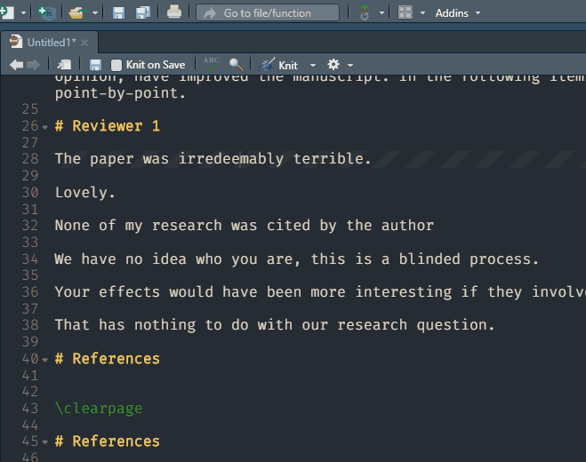

<!-- README.md is generated from README.Rmd. Please edit that file -->

```{r, include = FALSE}
knitr::opts_chunk$set(
  collapse = TRUE,
  comment = "#>",
  out.width = "100%"
)
```

# revise

<!-- badges: start -->
[](https://github.com/conig/revise/actions)
<!-- badges: end -->

revise inserts tagged passages from a manuscript into a revision letter. It
reads Markdown, R Markdown, and Word manuscripts and produces PDF, Word, or
plain-text letters.

## Installation

You can install the development version of {revise} from [GitHub](https://github.com/conig/revise) with:

``` r
# install.packages("remotes")
remotes::install_github("conig/revise")
```

## Start a revision letter

Use `revise::revise_letter_pdf`, `revise::revise_letter_docx`, or
`revise::revise_letter_txt` as the R Markdown output format. In RStudio, the
**ReviewerComment** addin wraps selected text in an `asis` reviewer chunk and
adds a YAML header if one is missing. Rendering requires Pandoc, and PDF
letters also require LaTeX. For plain-text letters, set `title`, `authors`,
`journal`, and `manuscript` (the manuscript ID) in the YAML header.



## Tag the manuscript

In a Word manuscript, select the excerpt and add a comment containing only
`Revise::section-name`. In Markdown or R Markdown, use one of these forms:

```md
[An inline excerpt.]{#short}

<span id="html-excerpt">
An excerpt marked with an HTML span.
</span>

::: {#long}
## A longer excerpt

Use a fenced div to include multiple paragraphs or headings.
:::
```

## Insert an excerpt

Load the manuscript with `revise::read_manuscript()`, then use inline R in the
letter to insert an excerpt by its tag:

````{verbatim, lang = "markdown"}
---
output: revise::revise_letter_docx
---

```{r setup, include = FALSE}
man <- revise::read_manuscript("manuscript.docx", to_envir = FALSE)
```

```{asis reviewer-method}
Reviewer comment
```

In response to \Comment{reviewer-method}, we revised the passage as follows:

`r revise::get_revision("section-name", man)`
````

Pass `trust_manuscript = TRUE` to `get_revision()` only after reviewing or writing
the manuscript's inline R code. To insert the excerpt without running that code,
set `evaluate = FALSE`.

To explore the tags in the bundled Word example:

```{r}
docx_path <- system.file("examples/word_test.docx", package = "revise")
man <- revise::read_manuscript(docx_path, to_envir = FALSE)
cat(paste(names(man$sections), collapse = ", "), "\n", sep = "")
revise::get_revision("hard", man)
```

## Add manuscript page references

For a PDF revision letter, attach the PDF rendered from the current manuscript:

```r
man <- revise::read_manuscript("manuscript.Rmd", PDF = "manuscript.pdf",
                               to_envir = FALSE)
```

Use `PDF = TRUE` if the PDF sits alongside the manuscript and shares its base
name. `get_revision()` adds the matching page or page range. If it cannot locate
the excerpt, it warns and prints `Pg. ?`. Page references are LaTeX; set
`include_pgnum = FALSE` in `get_revision()` when reusing that manuscript in a
Word or plain-text letter.

## Number reviewer comments across sections

PDF reviewer comment numbers reset at section headings by default. To keep
numbering continuous, use this YAML:

```yaml
output:
  revise::revise_letter_pdf:
    comment_reset_by_section: false
```
